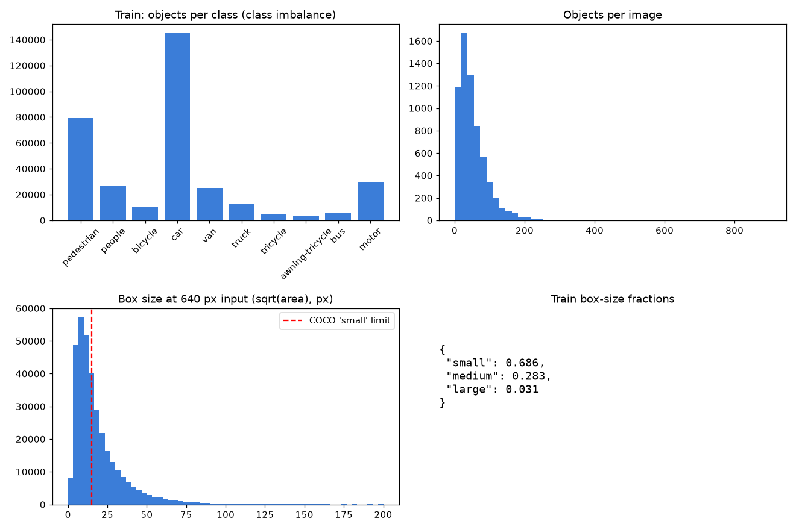
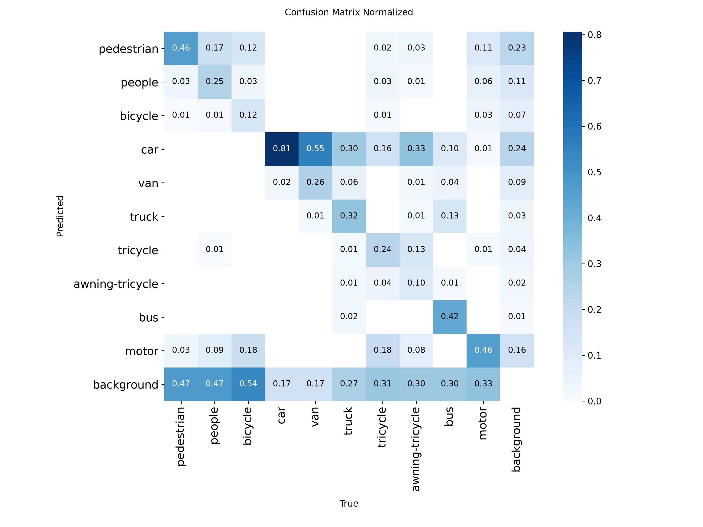
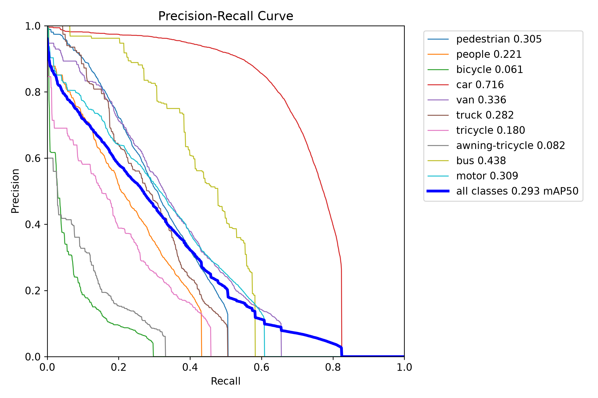
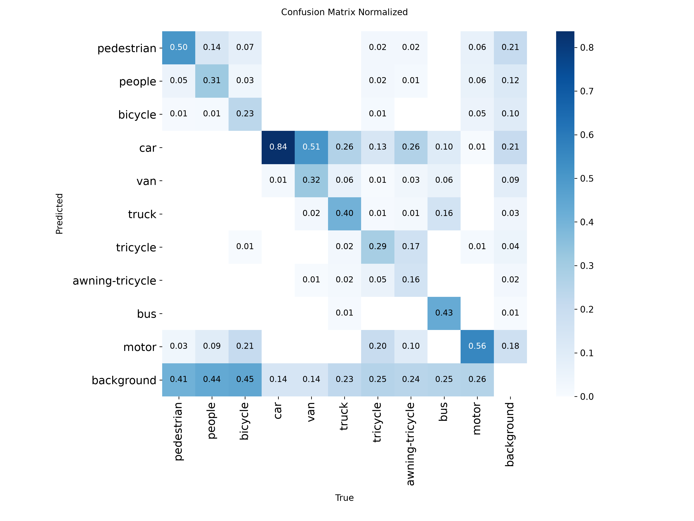
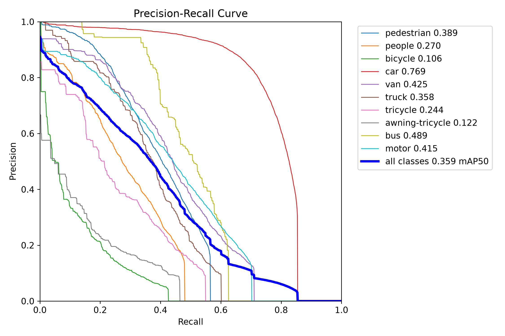

# Results (measured)

Generated by `scripts/make_results.py` from `training/reports/*.json`. Hardware: laptop RTX 3050 6 GB, Intel i5-13420H. mAP values are percentages. Latencies are single-image, batch 1, 640 px.

## 1. Data (VisDrone2019-DET)

* train: 6471 images, 343,205 objects (53.0 per image, max 902)
* val: 548 images, 38,759 objects
* box sizes (train): small 68.6 %, medium 28.3 %, large 3.1 %
* class counts: pedestrian 79,337, people 27,059, bicycle 10,480, car 144,867, van 24,956, truck 12,875, tricycle 4,812, awning-tricycle 3,246, bus 5,926, motor 29,647



## 2. Baseline on COCO (500 fixed val2017 images, pycocotools)

| model | mAP@.5:.95 | mAP@.5 | AP small | AP medium | AP large | latency (PyTorch, GPU) | params |
|---|---|---|---|---|---|---|---|
| yolo11n | 40.6 | 55.5 | 21.3 | 47.5 | 58.2 | 14.8 ms | 2.62 M |
| yolo11s | 47.8 | 64.1 | 28.5 | 56.2 | 63.9 | 18.0 ms | 9.46 M |
| faster_rcnn_r50_fpn_v2 | 49.4 | 70.4 | 34.8 | 53.5 | 63.6 | 206.0 ms | 43.71 M |

## 3. Domain gap: before vs after fine-tuning

VisDrone val, scored only on classes COCO also has (person, bicycle, car, truck, bus, motorcycle; pedestrian + people merged into person), same images and evaluator before and after.

| model | mAP@.5:.95 COCO weights | mAP@.5:.95 fine-tuned | AP small before | AP small after |
|---|---|---|---|---|
| yolo11n | 7.8 | 19.4 | 2.3 | 8.9 |
| yolo11s | 12.2 | 23.5 | 4.4 | 12.0 |

## 4. Fine-tuned models on VisDrone val (all 10 classes)

| model | mAP@.5:.95 | mAP@.5 | precision | recall | AP small | AP medium | AP large |
|---|---|---|---|---|---|---|---|
| yolo11n-visdrone | 16.4 | 29.3 | 42.0 | 32.1 | 7.0 | 23.9 | 40.8 |
| yolo11s-visdrone | 20.8 | 35.9 | 48.9 | 36.9 | 9.6 | 30.1 | 48.4 |

mAP / precision / recall come from Ultralytics' validator; the AP-by-size columns come from pycocotools on the same predictions. The two evaluators differ slightly (precision-recall interpolation, max 300 vs 100 detections per image), so pycocotools' overall mAP is ~1 point lower — compare numbers only within one evaluator.

### Per-class AP@.5:.95

| class | yolo11n-visdrone | yolo11s-visdrone |
|---|---|---|
| pedestrian | 12.2 | 17.0 |
| people | 7.1 | 9.4 |
| bicycle | 1.9 | 4.0 |
| car | 46.8 | 52.3 |
| van | 22.5 | 29.2 |
| truck | 17.7 | 23.4 |
| tricycle | 9.8 | 13.3 |
| awning-tricycle | 5.2 | 7.4 |
| bus | 28.8 | 34.2 |
| motor | 11.8 | 17.2 |

### yolo11n-visdrone: normalised confusion matrix and PR curves




### yolo11s-visdrone: normalised confusion matrix and PR curves




### Error analysis (read from the yolo11s-visdrone normalised confusion matrix; columns = true class)

1. **Missed small objects dominate.** 41 % of pedestrians, 44 % of "people" and 45 % of bicycles end up
   as *background* (not detected at all), versus 14 % of cars. These are the smallest objects in the
   dataset (68.6 % of all boxes are < 32×32 px), which is also why AP_small (9.6) is a fraction of
   AP_large (48.4). → Biggest lever: higher input resolution or tiled inference (SAHI), a stride-4 (P2) head.
2. **Look-alike vehicles from above.** 51 % of vans are predicted as *car* — more often than as van (32 %);
   26 % of trucks → car, 16 % of buses → truck. From a top-down view the cues that separate them (height,
   side windows) are mostly invisible. → More van/truck data, or merge classes if the business question
   only needs "vehicle".
3. **Two-wheel / three-wheel confusion.** bicycle → motor 21 %, tricycle → motor 20 %,
   awning-tricycle → tricycle 17 %. Rare classes (awning-tricycle has 3,246 training boxes vs 144,867 cars)
   also get the lowest AP. → Class-balanced sampling or loss weighting.
4. **pedestrian vs people** (VisDrone's "walking" vs "standing/sitting" person): 14 % of *people* are labelled
   *pedestrian*. The difference is posture, which is hard to see at a few pixels tall; for counting use-cases
   the two can be merged into "person" (as the domain-gap comparison does).

### Optimisation findings (section 5)

* **GPU FP32 vs FP16:** FP16 was *not* faster for the nano models (19.0 → 21.6 ms) and only modestly faster for
  the small models (25.6 → 23.1 ms). At batch 1 the nano model is too small to be compute-bound — time goes to
  kernel launches, memory copies and CPU-side pre/post-processing (~6–8 ms) — so halving the arithmetic barely
  matters. FP16 pays off for bigger models / batches.
* **CPU dynamic INT8 was *slower*** than FP32 (e.g. 55.6 → 72.6 ms) because dynamic quantisation re-quantises
  activations at run time and ONNX Runtime falls back to slower kernels for many quantised conv patterns. Static
  INT8 with a calibration set (or OpenVINO on Intel CPUs) is the right tool — measured, not assumed.
* **Parity:** an early check matched only 92 % of boxes. The cause was the *reference*: Ultralytics' `predict()`
  letterboxes to a minimal rectangle (`auto=True`) while our static ONNX model needs a 640×640 square, so the two
  sides saw different pixels. Feeding both identical input gives 100 % box matches and raw-output differences
  below 0.008 px — the export and our post-processing are exact.

## 5. ONNX export: parity and serving latency

Latency = our full serving path (letterbox + ONNX Runtime + NMS) per image. Parity = boxes from our ONNX pipeline matched (IoU > 0.9, same class) to Ultralytics/PyTorch boxes.

| model | ONNX MB | parity match | mean IoU | CPU fp32 | CPU int8 (dynamic) | GPU fp32 | GPU fp16 |
|---|---|---|---|---|---|---|---|
| yolo11n-coco | 10.2 | 100.0 | 0.9982 | 55.6 ms | 72.6 ms | 19.0 ms | 21.6 ms |
| yolo11s-coco | 36.3 | 100.0 | 0.9984 | 103.3 ms | 153.0 ms | 25.6 ms | 23.1 ms |
| yolo11n-visdrone | 10.2 | 100.0 | 0.9974 | 50.6 ms | 76.3 ms | 17.5 ms | 18.3 ms |
| yolo11s-visdrone | 36.2 | 100.0 | 0.9971 | 128.0 ms | 188.5 ms | 30.7 ms | 23.0 ms |

## 6. End-to-end pipeline (decode → detect → track → analytics)

```json
{
  "model": "yolo11n-coco",
  "video": "pedestrians.avi",
  "cuda": {
    "provider": "CUDAExecutionProvider",
    "frames": 300,
    "resolution": "768x576",
    "end_to_end_fps": 36.7,
    "avg_detector_ms": 24.24,
    "unique_objects": {
      "person": 16,
      "truck": 1,
      "car": 1,
      "dog": 1
    },
    "line": {
      "in": {
        "person": 2
      },
      "out": {
        "person": 5
      }
    }
  },
  "cpu": {
    "provider": "CPUExecutionProvider",
    "frames": 300,
    "resolution": "768x576",
    "end_to_end_fps": 18.8,
    "avg_detector_ms": 49.94,
    "unique_objects": {
      "person": 16,
      "truck": 1,
      "car": 1,
      "dog": 1
    },
    "line": {
      "in": {
        "person": 2
      },
      "out": {
        "person": 5
      }
    }
  }
}
```
